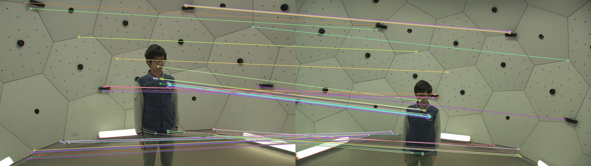
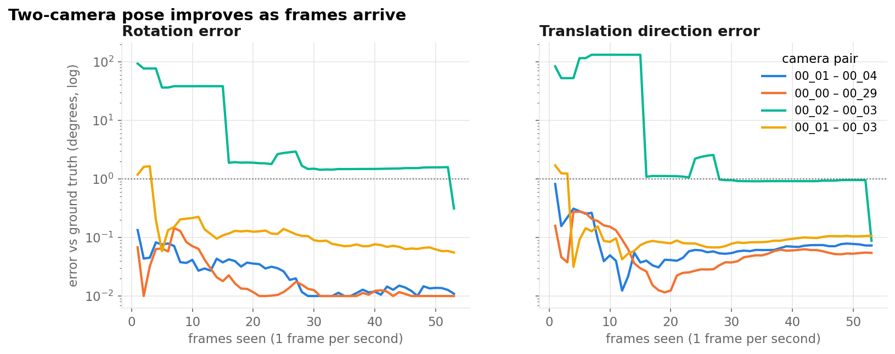
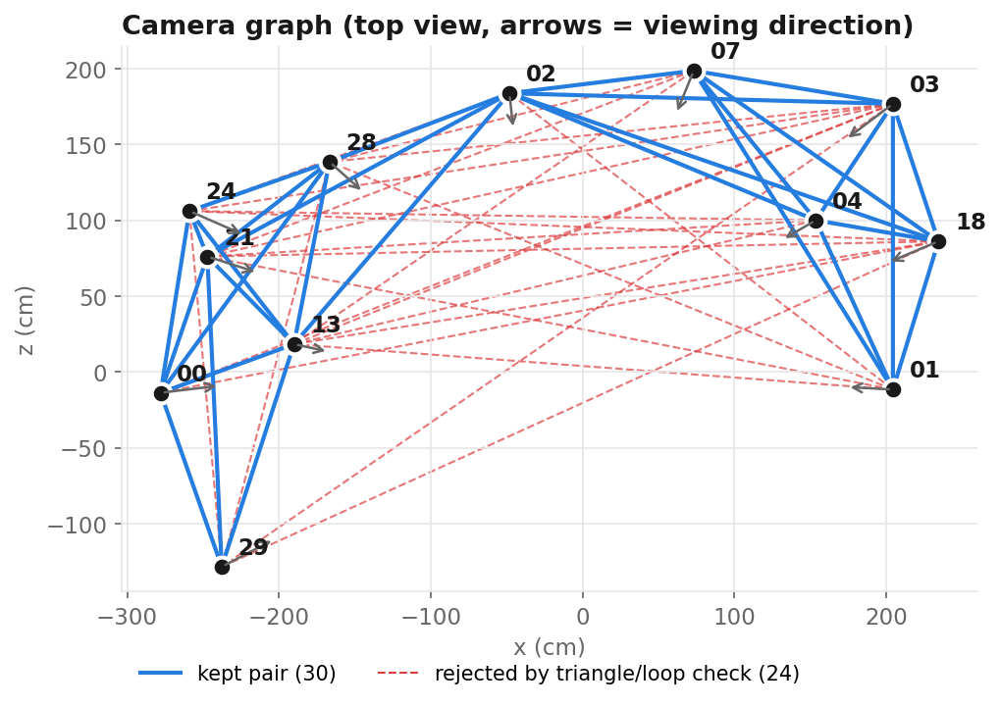
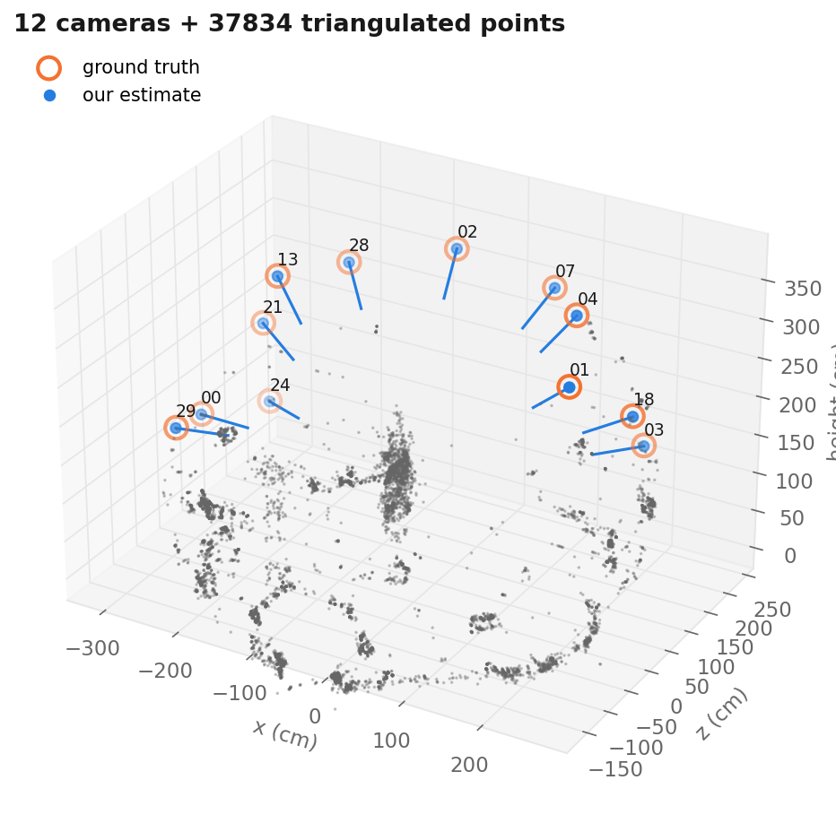
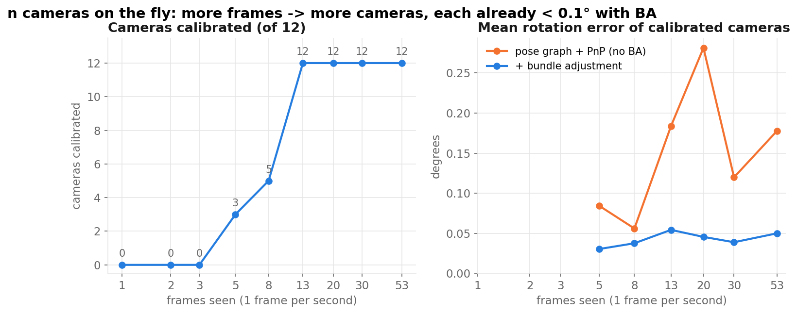

# Vinh's Approach: Finding Where Cameras Are, Without a Checkerboard

EECE 7150, AFR Group 1, Project 3: Calibration on the fly (extrinsics), Camera to Camera, then many cameras.
Presentation: **12/02/2026**

## The problem

We have many cameras looking at the same room. We want to know **where each
camera is** and **which way it is pointing**.

The usual way is to hold a checkerboard in front of the cameras. We do **not**
use a checkerboard. We only use what the cameras normally see: the walls, the
floor, and a person moving around. The answer should also get better the
longer the cameras watch. That is what "on the fly" means.

## The result

We tested on 12 cameras in a dome at Carnegie Mellon (the CMU Panoptic
dataset). The dataset also gives the true camera positions, so we can check
how close we are.

| What we measured | Result |
|---|---|
| Cameras found | **12 out of 12** |
| How far off the pointing direction is | **0.05 degrees** on average |
| How far off the camera position is | **less than 1 cm**, for cameras 1.2 to 5.4 m apart |
| How much video it needs | **13 seconds** to find all 12 cameras |
| Real measurement we give it | only **one** distance between two cameras |

## How it works, in 6 steps

### Step 1: Find the same spots in two cameras

The computer looks for small spots that stand out in each picture, like the
corner of a wall panel or a logo on a shirt. Then it pairs them up: "this spot
in camera A is the same spot in camera B."



### Step 2: Work out where camera B is compared to camera A

If you know where the same spots appear in both pictures, there is only one way
the two cameras can be placed to explain it. The computer finds that placement.

Some pairs of spots are wrong. So the computer tries many small random groups of
spots and keeps the answer that most spots agree with. Wrong spots get ignored.

One picture cannot tell size. A big room far away looks the same as a small
room close up. So at this point we know the direction to the other camera, but
not the distance.

### Step 3: Get better with every new frame ("on the fly")

From only one picture, cameras that are far apart find very few matching spots.
The dome walls are plain and look the same everywhere.

But the person in the room keeps moving. Every new frame gives new spots. We
keep adding them and recompute the answer each time. We also keep the old
answer if it still fits better, so the result stays steady and does not jump
around.



The green line is a hard pair of cameras. It starts very wrong, and after 16
seconds it becomes correct.

### Step 4: Throw away wrong camera pairs

12 cameras make 66 pairs. More than half of them give wrong answers, mostly
cameras on opposite sides of the dome that see different walls.

To catch them, we use a simple rule with three cameras A, B and C:

> Turning from A to B, then from B to C, must be the same as turning from A to C directly.

If a pair breaks this rule, it is wrong and we drop it. We never look at the
true answer to do this.



Later we checked against the true answer: every pair we dropped really was
wrong, and we did not drop any good pair.

### Step 5: Put all cameras together

1. Start with the best pair of cameras. Give it **one real distance** (125 cm) so everything has the right size.
2. Use those two cameras to find where the matching spots are in 3D.
3. Add the next camera by asking: "where must this camera be to see these 3D spots the way it does?"
4. Repeat until all 12 cameras are placed.

### Step 6: Fine tune everything together

Small errors add up as cameras are added. So at the end, the computer nudges
all cameras and all 3D spots at the same time, until every spot lines up with
where it was really seen in each picture (to about one third of a pixel).



The grey dots are the 3D spots we rebuilt: the round dome wall and the person in the middle.

## How much video does it need?

| Seconds of video | Cameras found |
|---|---|
| 1 to 3 | 0 (not enough matching spots yet) |
| 5 | 3 |
| 8 | 5 |
| 13 or more | **all 12** |

Each camera is already accurate as soon as it is found. More video lets more cameras join.



## Things we learned

1. **One frame is not enough** when cameras are far apart. Watching for a few seconds fixes it.
2. **Recomputing from scratch each frame makes the answer jump.** Polishing the answer and keeping the better one makes it steady.
3. **Some wrong pairs look very confident**, because the walls repeat the same pattern. Counting matches does not catch them. The three camera rule does.
4. **The final fine tuning had a bug at first** and barely moved anything. After fixing it, the pointing error dropped from 0.18 to 0.05 degrees.

## Limits

* We tested on one recording only.
* We assume each camera's lens settings are already known (the project allows this).
* The scene must have something moving. A completely still room gives the same spots every frame.
* It is not live yet. Each update recomputes everything.
* Cameras that face each other across the room cannot be paired directly. They are connected through the cameras between them.

## How to run it

Open a terminal in this `vinh_approach` folder.

```bash
# Install the libraries
pip install -r requirements.txt

# Download the data (12 cameras, about 2 GB, about 2 minutes)
python3 scripts/download_panoptic.py

# Run the full 12 camera calibration
# (first time about 5 minutes, after that about 1 minute)
python3 scripts/run_pipeline.py

# Use only the first 10 seconds of video
python3 scripts/run_pipeline.py --frames 10

# Small demo: two cameras, one frame
python3 scripts/run_two_view.py

# "On the fly" experiments and their charts
python3 scripts/run_online.py --part A     # pairs of cameras, about 30 seconds
python3 scripts/run_online.py --part B     # all cameras, about 8 minutes

# Make the pictures for the slides
python3 scripts/make_figures.py
```

All pictures and numbers are saved in `results/`.

## Which file does what

| Step | File |
|---|---|
| Download data | `scripts/download_panoptic.py` |
| Load pictures and lens settings | `src/data_loader.py` |
| Step 1: find and match spots | `src/features.py`, `src/cache.py` (saves results so it only runs once) |
| Step 2: place camera B from camera A | `src/two_view.py` |
| Step 3: improve with each frame | `src/online.py` |
| Step 4: drop wrong pairs | `src/pose_graph.py` |
| Step 5: put all cameras together | `src/sfm.py` |
| Step 6: fine tune | `src/bundle_adjustment.py` |
| Check against the true answer | `src/metrics.py` |

## Folder layout

```
vinh_approach/
│
├── README.md            📖 for people: this explanation
├── CLAUDE.md            🤖 for Claude Code: teammates' Claude gets the project instantly
├── requirements.txt     libraries to install
├── .gitignore           keeps data, PDFs and temporary files off GitHub
│
├── papers/              📄 reading (PDFs stay on your computer only)
│   ├── Nister2003_five_point_relative_pose.pdf       main method
│   ├── Carrera2011_SLAM_multicamera_calibration.pdf  similar past work
│   └── README.md
│
├── data/                💾 dataset (stays on your computer only, 2.5 GB)
│   ├── README.md
│   └── 171026_pose1/    true camera positions + videos + pictures + saved results
│
├── src/                 🧠 HOW it works (one file per step)
│   ├── data_loader.py        load pictures and lens settings
│   ├── features.py           step 1  find and match spots
│   ├── cache.py              step 1  save results, reuse them
│   ├── two_view.py           step 2  place camera B from camera A
│   ├── online.py             step 3  improve with each frame
│   ├── pose_graph.py         step 4  drop wrong pairs
│   ├── sfm.py                step 5  put all cameras together
│   ├── bundle_adjustment.py  step 6  fine tune
│   ├── metrics.py                    check against the true answer
│   └── plots.py                      chart style
│
├── scripts/             ▶️ WHAT you run
│   ├── download_panoptic.py  get the data
│   ├── run_two_view.py       small demo: two cameras, one frame
│   ├── run_pipeline.py       full 12 camera calibration
│   ├── run_online.py         "on the fly" experiments
│   └── make_figures.py       pictures for the slides
│
└── results/             📊 WHAT you show
    ├── online_pairs.png        on the fly, two cameras
    ├── online_ncam.png         on the fly, all 12 cameras
    ├── camera_graph.png        kept pairs and dropped pairs
    ├── cameras_3d.png          our cameras vs the true positions
    ├── per_camera_error.png    error for each camera
    ├── matches_00_00_00_29.jpg example of matched spots
    ├── *.csv, pipeline_result.json   the numbers
    └── two_view/               small demo pictures
```

## Words you may hear in the presentation

| Word | Plain meaning |
|---|---|
| Extrinsics | where a camera is and which way it points |
| SIFT | the method that finds spots that stand out in a picture |
| RANSAC | try many small random groups, keep the answer most agree with |
| Essential matrix | the math that links matching spots in two cameras |
| Triangulation | two cameras see a spot, so we can find where it is in 3D |
| PnP | place a new camera from 3D spots it can see |
| Bundle adjustment | the final fine tuning of everything together |

## Papers

* D. Nistér, "An Efficient Solution to the Five-Point Relative Pose Problem", CVPR 2003. This is how we do step 2.
* G. Carrera, A. Angeli, A. J. Davison, "SLAM-Based Automatic Extrinsic Calibration of a Multi-Camera Rig", ICRA 2011. Similar past work to compare with.
* D. Lowe, SIFT, 2004. Finding spots (step 1).
* M. Fischler and R. Bolles, RANSAC, 1981. Ignoring wrong matches (step 2).
* B. Triggs and others, "Bundle Adjustment: A Modern Synthesis", 2000. Fine tuning (step 6).
* H. Joo and others, "Panoptic Studio", ICCV 2015. The dataset.
